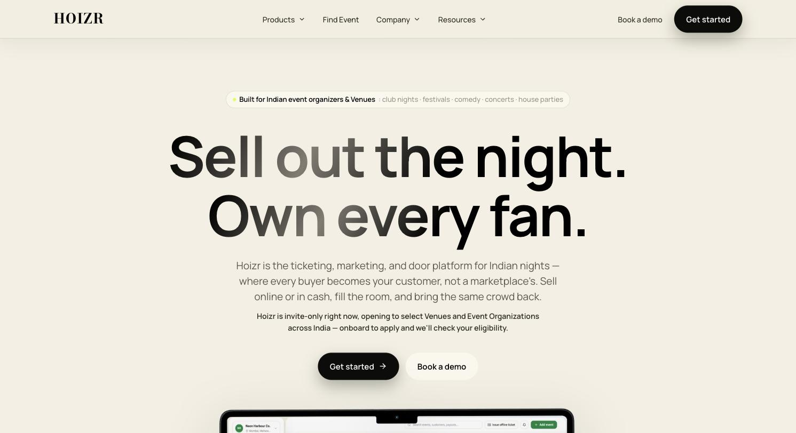
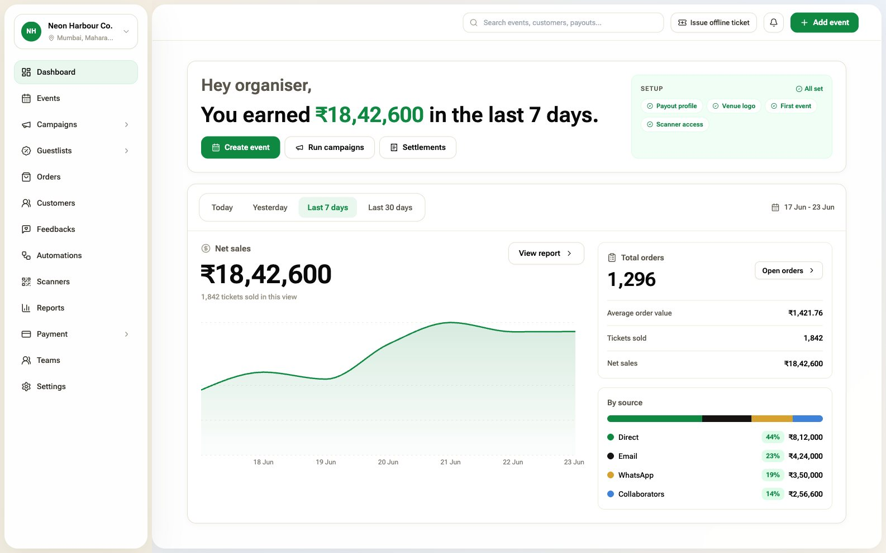
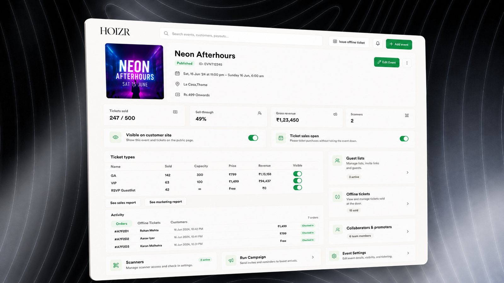
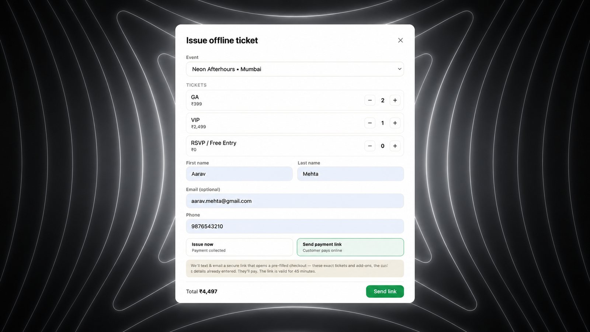
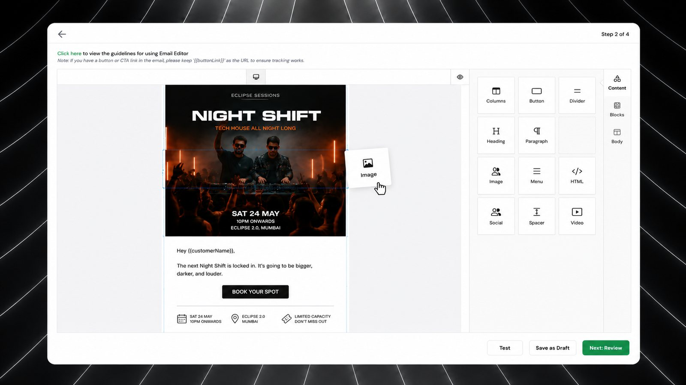
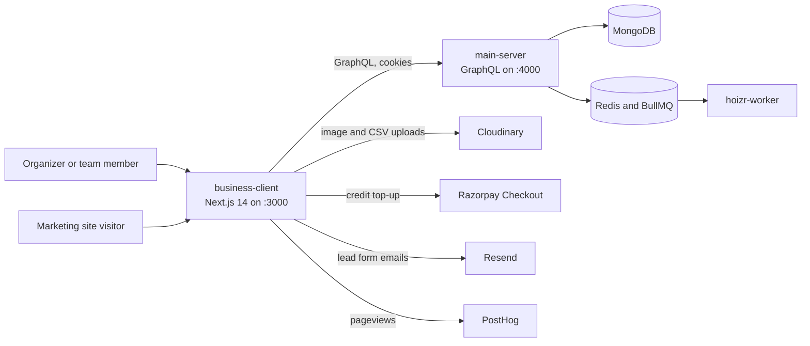
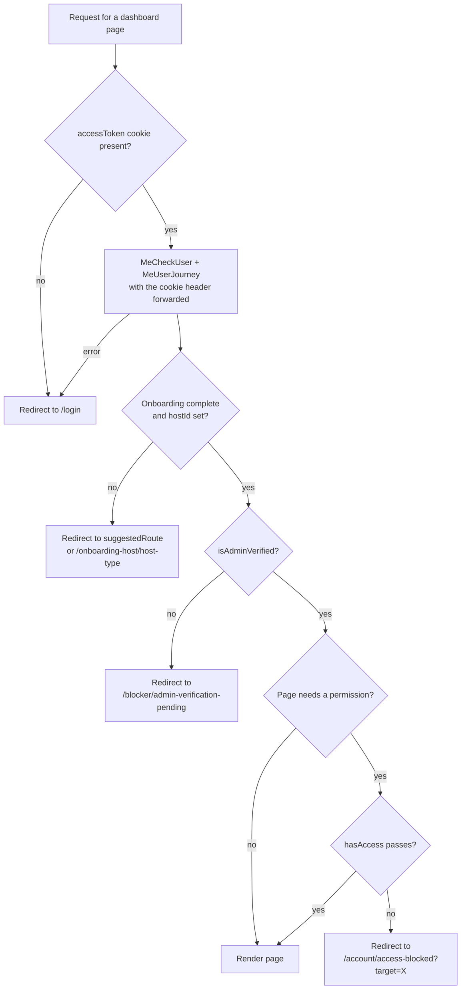
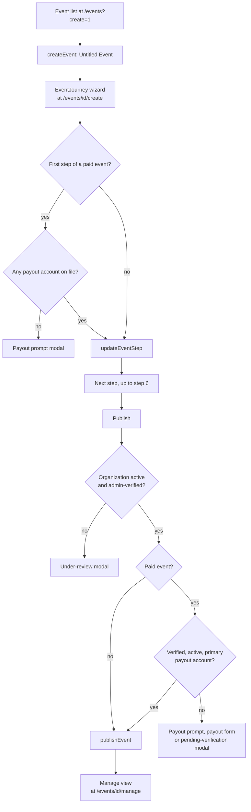

<div align="center">

# Hoizr Business (business-client)

Next.js dashboard where venues and event organizers run ticketed events on Hoizr, plus the business.hoizr.com site.

[Hoizr walkthrough](https://github.com/Hoizr-Technology/hoizr-walkthrough) · [Architecture](https://github.com/Hoizr-Technology/hoizr-walkthrough/blob/main/docs/01-system-architecture.md) · [Local setup](https://github.com/Hoizr-Technology/hoizr-walkthrough/blob/main/docs/09-local-development.md) · [Contributing](https://github.com/Hoizr-Technology/.github/blob/main/CONTRIBUTING.md)


</div>






## About

This repository is the web app that venues and event organizers use to run their business on [Hoizr](https://hoizr.com), an event ticketing, fan CRM, marketing and door-scanning platform built for India. Organizers and their team members sign in here to create and publish events, sell tickets, manage guestlists and door scanners, follow orders and customers, run email and WhatsApp campaigns, and manage payouts. The same Next.js deployment also serves the public marketing site at `business.hoizr.com`.

The app has no database of its own. Every piece of product data comes from the [main-server](https://github.com/Hoizr-Technology/main-server) GraphQL API through a typed SDK generated with GraphQL Code Generator. In the code, an organization is called a **host** (`hostId`, `getHost`, `/onboarding-host`). For how this app fits next to the storefront, the workers and the scanner app, start with the [Hoizr walkthrough](https://github.com/Hoizr-Technology/hoizr-walkthrough).

## Contents

- [Highlights](#highlights)
- [Features](#features)
- [Tech stack](#tech-stack)
- [Architecture](#architecture)
- [Route map](#route-map)
- [Getting started](#getting-started)
- [Testing and quality](#testing-and-quality)
- [Known limitations](#known-limitations)
- [Contributing](#contributing)
- [Related repositories](#related-repositories)
- [Author](#author)
- [License](#license)

## Highlights

- **Two routers, one app.** The App Router serves the marketing site, `/login`, `/signup`, `/select-host`, the signed-in `/dashboard`, three `/api` route handlers and the RSS feeds. The Pages Router serves the rest of the dashboard. See [app/layout.tsx](app/layout.tsx) and [pages/_app.tsx](pages/_app.tsx).
- **Layered server-side guards on every dashboard page.** Session, then onboarding, then admin verification, then permission, all evaluated on the server (`getServerSideProps`, or the server component for `/dashboard`) before anything renders. The verification step is a pure function with no `next/*` imports, shared by 24 Pages Router pages: [lib/auth/verificationGate.ts](lib/auth/verificationGate.ts), [utils/hasAccess.tsx](utils/hasAccess.tsx).
- **Redirect-safe App Router auth.** The server helpers rethrow Next's `NEXT_REDIRECT` signal so a broad `catch` can never swallow a redirect, a fix for a real "stuck on /login" loop documented in [lib/auth/serverAuth.ts](lib/auth/serverAuth.ts).
- **Generated GraphQL SDK with refresh-and-retry in the transport.** 20 `.graphql` documents generate 106 SDK methods; a custom `fetch` on the `graphql-request` client catches HTTP 401, calls `tokensRefresh` and replays the request once ([codegen.yml](codegen.yml), [utils/graphqlClient.ts](utils/graphqlClient.ts)).
- **One time zone for every event time.** Organizers type wall-clock times in IST; the app stores UTC instants through paired `fromZonedTime` / `formatInTimeZone` calls, so previews never drift with the browser's zone ([components/modules/events/EventJourney.tsx](components/modules/events/EventJourney.tsx)).
- **URL-driven full-page panels.** `?panel=guestlists|customers|offline|collaborators` uses shallow routing and remembers whether the panel was pushed in-session, so Back closes it and a refresh or deep link restores it ([pages/events/[eventId]/[eventMode].tsx](pages/events/[eventId]/[eventMode].tsx)).
- **Tenant-scoped uploads with delete-on-replace in the safe order.** Dashboard uploads go straight from the browser to Cloudinary under `hoizr/{env}/hosts/{hostId}/…`, and the previous asset is deleted through main-server only after the new one lands ([utils/cloudinaryUpload.ts](utils/cloudinaryUpload.ts)).
- **One schema on both sides of a form.** The one-question-at-a-time lead forms validate each step on the client and re-validate the whole answer set in the route handler with the same pure functions, plus a honeypot and minimum-fill-time bot check ([lib/forms/schema.ts](lib/forms/schema.ts), [app/api/forms/route.ts](app/api/forms/route.ts)).
- **Server-verified payments from the browser.** The marketing-credit top-up opens Razorpay Checkout on a server-created order, verifies the signature server-side, then bumps a Zustand version counter so every credit-dependent view refetches ([components/common/topup/GlobalTopUpModal.tsx](components/common/topup/GlobalTopUpModal.tsx), [store/global.ts](store/global.ts)).

## Features

### Accounts, organizations and teams

- One-time-code login by email or phone (phone codes depend on the backend's feature-flagged SMS), and signup with code verification ([app/(auth)/login/LoginClient.tsx](app/%28auth%29/login/LoginClient.tsx)).
- One user can belong to several organizations and switch between them at `/select-host`.
- Three-step organization onboarding (type, address with place autocomplete, additional info), then a waiting screen until an internal admin verifies the organization.
- Team members with roles and per-permission checkboxes, email verification for invitees, and an activity log.
- Settings modal with account details, authenticator-app two-factor setup, "log out of all devices" and organization details ([components/common/settings/SettingsModal.tsx](components/common/settings/SettingsModal.tsx)).

### Events

- Six-step event wizard: Event Category, Basic Details, Location, Tickets, Lineup and Additional, saved per step as a draft.
- Event types: free RSVP, exclusive and non-exclusive. Ticket categories: RSVP, normal, table and group. Multi-day events with per-day dates.
- Publish checks that the organization is verified and, for paid events, that a verified primary payout account exists.
- Manage view with full-page panels for guestlists, customers, offline tickets and collaborators, plus per-ticket visibility toggles.



- Collaborators: add other organizations to an event from the wizard. A collaborator sees the event read-only in its own `/events` list and can leave the collaboration.

<!-- SCREENSHOT: business-event-create | /events/{id}/create on the Tickets step of the six-step wizard -->

### Door and guestlists

- Door scanners per event: create, edit, delete, regenerate the access code (shown once), revoke every scanner session for an event, and reverse a check-in with a required reason ([components/modules/events/EventScanners.tsx](components/modules/events/EventScanners.tsx)).
- Scan log per event, and an all-events scanner list at `/scanners`.
- Guestlists: create lists, approve or revoke entries, export entries as CSV, and set event-level guestlist options ([components/modules/events/GuestlistManagerModal.tsx](components/modules/events/GuestlistManagerModal.tsx)).

<!-- SCREENSHOT: business-scanners | /events/{id}/scanners with the scanner list, scan log, revoke-all and reverse check-in actions -->

### Sales and customers

- Orders (online and offline) with a full-screen receipt. Refunds are owner-only in the UI and use a two-step confirm ([components/common/orders/OrderReceiptModal.tsx](components/common/orders/OrderReceiptModal.tsx)).
- Offline tickets: issue a ticket directly, or send the buyer a payment link ([components/modules/offlineTicket/IssueOfflineTicketModal.tsx](components/modules/offlineTicket/IssueOfflineTicketModal.tsx)).
- Ticket tiers and sold counts across events, a customers table with loyalty points, and per-customer order history.
- Promo codes, a loyalty reward catalogue, a community leaderboard and customer feedback per event.

### Marketing

- Email campaigns with a drag-and-drop editor (Unlayer), audience targeting with counts, CSV import of recipients, test sends and scheduling.
- WhatsApp campaigns and template authoring with review submission. Delivery runs through MSG91 on the backend and is feature-flagged there.
- Always-on automations per organization, with on/off and channel switches and a per-event breakdown ([utils/automationClient.ts](utils/automationClient.ts)).
- Prepaid marketing credit: balance, ledger, a reputation tier and Razorpay top-up.
- A push campaign builder exists, but the sidebar shows Push, SMS and Instagram with a "Soon" badge and disables them; SMS and Instagram are placeholder screens.



### Money and insights

- Payout accounts, settlement history and payout invoices under `/payment`.
- Dashboard KPIs: net sales, tickets sold, average order value, sales by source, a launch-readiness checklist and upcoming events.
- 21 reports in 7 groups (sales, payouts, marketing, fans, event operations, website funnel, advanced), all rendered by one generic page from a single `getHostReport` query that returns typed metric, table and chart descriptors ([pages/reports/index.tsx](pages/reports/index.tsx), [pages/reports/[reportType].tsx](pages/reports/[reportType].tsx)).

<!-- SCREENSHOT: business-reports | /reports/sales-summary rendered by the generic report page: metric tiles, a chart and a table -->

### Developers (early preview)

- API keys (secret, or publishable with an allowed-domains list). The raw key is shown once at creation; the list shows only a prefix and the last four characters.
- Webhook endpoints for `order.paid`, `order.refunded` and `order.cancelled`, with signing-secret rotation and receiver-side verification instructions. Deliveries are sent by the [hoizr-worker](https://github.com/Hoizr-Technology/hoizr-worker) repo.
- A whitelabel request form, in the dashboard and on the public `/developers` page.
- Keys can be created and revoked today, but no public API consumes them yet.

<!-- SCREENSHOT: business-developers | /org-settings/developers/webhooks with one endpoint and the signature verification note -->

### Marketing site (business.hoizr.com)

- Home, about, how it works, a product catalogue with 20 product slugs, a blog whose posts live in code, help, resources, contact, legal pages and a book-a-demo page.
- Conversational lead forms at `/get-started` and `/partner`, posting to `/api/forms`.
- Generated `sitemap.xml` and `robots.txt` (dashboard routes disallowed), RSS feeds at `/rss.xml` and `/feed.xml`, `llms.txt`, JSON-LD and build-time blurhash image placeholders.

## Tech stack

Versions are the resolved versions in `yarn.lock`.

| Technology | Version | Purpose here | Docs |
|---|---|---|---|
| Next.js | 14.2.4 | App Router (marketing, auth, `/dashboard`, route handlers) and Pages Router (dashboard) | [nextjs.org/docs](https://nextjs.org/docs) |
| React | 18.3.1 | UI | [react.dev](https://react.dev) |
| TypeScript | 5.4.5 | `strictNullChecks` on, `strict` off ([tsconfig.json](tsconfig.json)) | [typescriptlang.org](https://www.typescriptlang.org/docs/) |
| GraphQL Code Generator | 5.0.2 | `typescript` + `typescript-operations` + `typescript-graphql-request` plugins build `generated/graphql.ts` | [the-guild.dev/graphql/codegen](https://the-guild.dev/graphql/codegen/docs/getting-started) |
| graphql-request | 7.0.1 | Transport for the SDK and hand-written operations, with a custom 401-refresh `fetch` | [graffle-js/graffle](https://github.com/graffle-js/graffle) |
| Zustand | 4.5.2 | 20 client stores; global modals and toasts live in `store/global.ts` | [zustand.docs.pmnd.rs](https://zustand.docs.pmnd.rs/) |
| Tailwind CSS | 3.4.4 | Styling, with separate token files for the dashboard, marketing site and lead forms | [v3.tailwindcss.com](https://v3.tailwindcss.com/docs/installation) |
| shadcn/ui (Radix UI) | Radix Dialog 1.1.2 and others | 35 components in `components/ui/`, mostly shadcn/ui primitives | [v3.shadcn.com](https://v3.shadcn.com/docs) |
| TanStack Table | 8.20.5 | Data tables in `components/common/dataTable/` | [tanstack.com/table](https://tanstack.com/table/latest/docs) |
| React Hook Form | 7.52.0 | Login, signup, onboarding and team forms | [react-hook-form.com](https://react-hook-form.com/docs) |
| date-fns / date-fns-tz | 4.1.0 / 3.2.0 | IST conversion for event times | [date-fns.org](https://date-fns.org/docs) |
| Recharts | 2.15.0 | Dashboard and report charts | [recharts.org](https://recharts.github.io/en-US/api/) |
| Framer Motion | 11.2.11 | Marketing and onboarding animation | [motion.dev](https://motion.dev/docs) |
| react-email-editor | 1.7.11 | Unlayer drag-and-drop email editor, loaded with `next/dynamic` | [unlayer/react-email-editor](https://github.com/unlayer/react-email-editor) |
| DOMPurify | 3.2.2 | Sanitizes rich text against a small tag allowlist ([components/common/RichTextEditor.tsx](components/common/RichTextEditor.tsx)) | [cure53/DOMPurify](https://github.com/cure53/DOMPurify) |
| Resend | 6.12.3 | Emails from the `/api/contact`, `/api/waitlist` and `/api/forms` route handlers | [resend.com/docs](https://resend.com/docs) |
| posthog-js | 1.376.0 | Product analytics with manual App Router pageviews; off when no key is set | [posthog.com/docs](https://posthog.com/docs/libraries/js) |
| Razorpay Checkout | script | Marketing-credit top-up payments (orders created and verified by main-server) | [razorpay.com/docs](https://razorpay.com/docs/payments/payment-gateway/web-integration/standard/) |
| Cloudinary | upload API | Logo, flyer, gallery, video and CSV uploads from the browser | [cloudinary.com/documentation](https://cloudinary.com/documentation/upload_images) |
| sharp + blurhash | 0.34.5 / 2.0.5 | `scripts/generate-blurhashes.mjs` writes `public/blurhash-manifest.json` before `dev` and `build` | [sharp.pixelplumbing.com](https://sharp.pixelplumbing.com) |
| ESLint | 8.57.0 | `next/core-web-vitals` config ([.eslintrc.json](.eslintrc.json)) | [nextjs.org ESLint](https://nextjs.org/docs/app/api-reference/config/eslint) |
| Yarn classic | 1.22.22 | Package manager (`packageManager` field, `yarn.lock` v1) | [classic.yarnpkg.com](https://classic.yarnpkg.com) |

## Architecture

### Where this app sits

The browser talks to main-server directly with `credentials: "include"`, and the server-side guards forward the incoming `cookie` header on their own calls. Session cookies are set and owned by main-server. Uploads go from the browser to Cloudinary, and the lead-form route handlers call Resend. This repo has no queues and no inbound webhooks; campaign sending, automations and webhook delivery run in main-server and the worker repo.



### Folder layout

```text
business-client/
├── app/                         # App Router
│   ├── (app)/dashboard/         # Signed-in home: SSR journey guard + KPI dashboard
│   ├── (auth)/                  # /login, /signup, /select-host
│   ├── (forms)/                 # /get-started, /partner conversational lead forms
│   ├── api/                     # contact, waitlist, forms route handlers (Resend)
│   ├── product/ blog/ legal/    # Marketing pages (plus about, help, contact, developers, ...)
│   ├── AppGlobals.tsx           # PostHog, waitlist context, payout modals, toast
│   ├── layout.tsx               # Root metadata: en-IN, Open Graph, robots
│   └── sitemap.ts, robots.ts    # Generated SEO files
├── pages/                       # Pages Router: most dashboard routes, each with SSR guards
│   ├── _app.tsx                 # Global modals, fonts, DefaultSeo, per-page layouts
│   ├── events/                  # List + [eventId]/[eventMode]: create | update | manage | scanners
│   ├── campaigns/, automations/, reports/, payment/, teams/, ...
│   └── org-settings/developers/ # API keys, webhooks, whitelabel request
├── components/
│   ├── ui/                      # 35 components, mostly shadcn/ui primitives
│   ├── common/                  # Data tables, global modals, top-up, payout, toast, rich text
│   ├── modules/                 # Feature modules: events, campaign, onboarding, payment, ...
│   ├── marketing/               # Marketing sections, product and blog data, JSON-LD
│   ├── forms/                   # Conversational form renderer
│   └── navigation/              # Sidebar and its route list
├── graphql/                     # 20 .graphql documents (codegen input)
├── generated/                   # graphql.ts (codegen output) + graphql-compat.ts (legacy-name shim)
├── lib/
│   ├── auth/                    # serverAuth.ts (App Router) + verificationGate.ts (pure)
│   └── forms/                   # Pure form schema, engine, journeys and a self-check
├── utils/                       # graphqlClient.ts, feature GraphQL clients, uploads, hasAccess
├── store/                       # 20 Zustand stores
├── styles/                      # globals.css + owner, marketing and forms token files
├── scripts/                     # generate-blurhashes.mjs (runs before dev and build)
├── public/                      # Images, logo, llms.txt, blurhash-manifest.json
└── docs/assets/                 # README images
```

### Flow: loading a protected dashboard page

There is no Next.js middleware in this repo. Each protected page checks the session on the server before it renders. The diagram shows the Pages Router chain; the App Router `/dashboard` runs the same checks and sends signed-out visitors to the marketing home with a `?next=` parameter.



1. A missing `accessToken` cookie redirects straight to `/login` ([pages/orders/index.tsx](pages/orders/index.tsx) is the canonical example).
2. `MeCheckUser` and `MeUserJourney` run in parallel through the generated SDK, forwarding the browser's cookies ([utils/graphqlClient.ts](utils/graphqlClient.ts)).
3. Incomplete onboarding sends the user to the route main-server suggests.
4. `verificationGateRedirect` parks an onboarded but unverified organization on the blocker page ([lib/auth/verificationGate.ts](lib/auth/verificationGate.ts)).
5. Pages that need a permission call `hasAccess`, which also accepts renamed legacy permission names ([utils/hasAccess.tsx](utils/hasAccess.tsx)).
6. In the App Router, [app/(app)/layout.tsx](app/%28app%29/layout.tsx) calls `requireAuthenticatedServer` and [app/(app)/dashboard/page.tsx](app/%28app%29/dashboard/page.tsx) repeats the onboarding, blocked and verification checks ([lib/auth/serverAuth.ts](lib/auth/serverAuth.ts)).

### Flow: from draft to published event



1. `/events/create` redirects to `/events?create=1`, where the list page calls `createEvent` and opens the wizard ([pages/events/index.tsx](pages/events/index.tsx)).
2. `EventJourney` saves each step with `updateEventStep`. For a paid event, `ensurePaidDraftHasPayoutAccount` asks for a payout account before the first save ([components/modules/events/EventJourney.tsx](components/modules/events/EventJourney.tsx)).
3. `openPublishFlow` saves the last step, then `ensureHostAccountPublishReady` checks the organization and `ensurePaidPublishPayoutReady` checks the payout account, using the pure helpers in [utils/payout-eligibility.ts](utils/payout-eligibility.ts).
4. `publishEvent` runs, and ticketing terms and refund policy are saved as organization defaults on a best-effort basis. A free event goes straight to the manage view; a paid event first shows a success modal with the public link on hoizr.com.
5. The manage view opens at `/events/{id}/manage`, with full-page panels driven by `?panel=` ([pages/events/[eventId]/[eventMode].tsx](pages/events/[eventId]/[eventMode].tsx)).

### Patterns worth studying

#### Redirect-safe server auth

`redirect()` in the App Router works by throwing. A `try/catch` meant for GraphQL failures will also catch the redirect, and the user stays on the page. Every server helper routes caught errors through this check first ([lib/auth/serverAuth.ts#L19-L29](lib/auth/serverAuth.ts#L19-L29)):

```ts
const isFrameworkRedirect = (error: unknown): boolean => {
  // Next 14 exposes isRedirectError; fall back to a string-match in
  // case the internal path changes between minor versions.
  try {
    if (isRedirectError(error)) return true;
  } catch {
    // ignore — fall through to the message check
  }
  const message = (error as { message?: string })?.message ?? "";
  return message === "NEXT_REDIRECT";
};
```

#### Refresh and retry inside the transport

Callers never handle token expiry. The `GraphQLClient` gets a custom `fetch` that refreshes on HTTP 401 and replays the original request once ([utils/graphqlClient.ts#L38-L49](utils/graphqlClient.ts#L38-L49)). The endpoint is also resolved without throwing at import time, so a build without env vars still completes.

```ts
if (response.status === 401) {
  try {
    const client = new GraphQLClient(endpoint, { credentials: "include" });
    await client.request(TOKEN_REFRESH_QUERY, {}, init?.headers);
    response = await fetch(input, init);
  } catch (error) {
    console.error("Error refreshing tokens:", error);
    if (typeof window !== "undefined" && window.location.pathname !== "/login") {
      window.location.href = "/login";
    }
  }
}
```

#### One time zone for every event time

There is a single `IST_TZ = "Asia/Kolkata"` constant. Saves convert IST wall-clock input to UTC with `fromZonedTime`; reads convert back with `formatInTimeZone` ([components/modules/events/EventJourney.tsx#L552-L561](components/modules/events/EventJourney.tsx#L552-L561)):

```ts
// Convert a stored UTC instant into the "YYYY-MM-DDTHH:mm" wall-clock string the
// datetime pickers expect, rendered in IST. Pairs with the fromZonedTime(...,IST)
// conversions on save: an instant of 2026-06-26T13:15Z reads back as the IST
// wall-clock "2026-06-26T18:45" — matching what the customer site shows.
const toDateTimeInput = (value?: string | Date | null) => {
  if (!value) return "";
  const date = new Date(value);
  if (Number.isNaN(date.getTime())) return "";
  return formatInTimeZone(date, IST_TZ, "yyyy-MM-dd'T'HH:mm");
};
```

#### More to read

- **Commit the cookie before navigating.** After `SetHostIdAsCookie`, the organization picker uses `window.location.assign` instead of `router.replace`, so the next server render sees the new cookie ([app/(auth)/select-host/SelectHostClient.tsx](app/%28auth%29/select-host/SelectHostClient.tsx)).
- **Hydration race guard.** `awaitSelectedHostId()` subscribes to the host store with a timeout, then falls back to an API lookup, instead of showing a false "no organization" error while the layout loads ([components/modules/events/EventJourney.tsx](components/modules/events/EventJourney.tsx)).
- **Delete on replace, in the safe order.** `uploadHostAsset` uploads first and only then asks main-server to delete the previous asset, tolerating a failed cleanup ([utils/cloudinaryUpload.ts](utils/cloudinaryUpload.ts)).
- **A migration shim instead of a rewrite.** `tsconfig.json` aliases `@/generated/graphql` to [generated/graphql-compat.ts](generated/graphql-compat.ts), which re-exports the codegen output and maps names from an earlier restaurant point-of-sale codebase onto the current schema. [utils/graphqlClient.ts](utils/graphqlClient.ts) does the same for renamed SDK methods.
- **Pure form engine with a self-check.** Steps declare `visible()` predicates, and [lib/forms/__selfcheck__.ts](lib/forms/__selfcheck__.ts) asserts schema and journey integrity plus branch navigation ([lib/forms/engine.ts](lib/forms/engine.ts), [lib/forms/journeys.ts](lib/forms/journeys.ts)).
- **App-wide modals from one store.** Toasts, top-up, payout prompts, settings, run-campaign and order receipts open through actions in [store/global.ts](store/global.ts), so any Pages Router page can trigger them without prop drilling.
- **Baseline response headers.** `X-Content-Type-Options`, `Referrer-Policy` and `X-Frame-Options` are set for every route in [next.config.mjs](next.config.mjs).

## Route map

<details>
<summary>Dashboard routes (Pages Router unless noted)</summary>

"Guards" means the session, onboarding and admin-verification checks described in [Architecture](#flow-loading-a-protected-dashboard-page). A permission name means the page also calls `hasAccess` during SSR.

| Path | Purpose | Access |
|---|---|---|
| `/dashboard` (App Router) | KPI summary, launch checklist, upcoming events; `?settings=` asks the store to open the settings modal, which is not mounted here yet (see [Known limitations](#known-limitations)) | Guards |
| `/events` | Event list, create, duplicate, delete | Guards |
| `/events/[eventId]/create`, `/update` | Six-step event wizard | Guards |
| `/events/[eventId]/manage` | Manage view with `?panel=guestlists\|customers\|offline\|collaborators` | Guards |
| `/events/[eventId]/scanners` | Scanners and scan log for one event | Guards |
| `/orders` | Online and offline orders, receipt and refund | Guards + `Tickets` |
| `/tickets` | Ticket tiers and sold counts | Guards + `Tickets` |
| `/customer` | Customers, loyalty points, per-customer orders | Guards + `Customers` |
| `/coupons` | Promo codes | Guards |
| `/rewards/loyalty-settings` | Loyalty reward catalogue | Guards |
| `/community` | Loyalty leaderboard | Guards |
| `/feedbacks` | Customer feedback per event | Guards |
| `/automations`, `/automations/[key]` | Always-on automations | Guards |
| `/campaigns/[campaignRoute]` | `email`, `whatsapp`, `push`, `sms`, `instagram` channel pages | Guards |
| `/campaigns/onboarding/[campaignOnboardingRoute]` | Email campaign wizard | Guards |
| `/campaigns/whatsapp/onboarding/[step]` | WhatsApp campaign wizard | Guards |
| `/campaigns/marketing-credit` | Credit balance, ledger, reputation tier, top-up | Guards |
| `/scanners` | Scanners across all events | Guards + `Events` |
| `/reports`, `/reports/[reportType]` | Report catalogue and generic renderer | Guards + `Reports` (export needs `DownloadReports`) |
| `/payment/[paymentSlug]` | `payouts`, `settlement-history`, `invoices` | Guards + `PayoutManagement` |
| `/teams` | Team members, roles, permissions | Guards + `TeamManagement` |
| `/teams/activity-log` | Offline-ticket activity by team members and collaborators | Guards + `UpdateHost` |
| `/org-settings/developers`, `/webhooks`, `/whitelabel` | API keys, webhooks, whitelabel request | Guards |
| `/onboarding-host/[onBoardingRoute]` | `host-type`, `host-address`, `host-additional-info` | Session only |
| `/blocker/admin-verification-pending` | Waiting for admin verification | Session only |
| `/email-verification/verify-user/[subUserToken]` | Team-member email verification | Public |
| `/login`, `/signup` (App Router) | One-time-code auth | Public, redirects if signed in |
| `/select-host` (App Router) | Pick an organization | Session |

Redirect-only routes: `/events/create` → `/events?create=1`, `/events/[eventId]` → `/events/[eventId]/manage`, `/campaigns` → `/campaigns/email`, `/payment` → `/payment/payouts`, `/org-settings` → `/dashboard?settings=brand`, `/profile` → `/dashboard?settings=account`.

</details>

<details>
<summary>Marketing routes and route handlers (App Router)</summary>

| Path | Purpose |
|---|---|
| `/` | Home |
| `/about`, `/how-it-works`, `/resources`, `/help`, `/contact` | Static marketing pages |
| `/product`, `/product/[slug]` | Product catalogue, slugs from [components/marketing/data/nav-products.ts](components/marketing/data/nav-products.ts) |
| `/blog`, `/blog/[slug]` | Blog, posts in [components/marketing/blog/blog-data.ts](components/marketing/blog/blog-data.ts) |
| `/legal/[slug]` | `privacy`, `terms`, `cookies`, `entity` |
| `/book-a-demo` | Scheduling embed |
| `/developers` | Developer page and whitelabel request form |
| `/get-started`, `/partner` | Conversational lead forms |
| `/sitemap.xml`, `/robots.txt`, `/rss.xml`, `/feed.xml` | Generated by `app/sitemap.ts`, `app/robots.ts` and route handlers |
| `POST /api/contact` | Contact form: confirmation and internal notification through Resend |
| `POST /api/waitlist` | Waitlist and account requests through Resend |
| `POST /api/forms` | Lead forms: allowlisted `formType`, honeypot, minimum fill time, schema validation |

`/pricing` permanently redirects to `/about`, and retired product slugs redirect to their closest live product ([next.config.mjs](next.config.mjs)).

</details>

<details>
<summary>GraphQL documents consumed from main-server</summary>

| Document | Operations |
|---|---|
| `auth.graphql` | userLogin, userLoginVerification, UserSignUp, userSignupVerification, userLogout, userLogoutFromEverywhere, MeUser, MeCheckUser, MeUserJourney, MeContactDetails, MarkWalkthroughDone |
| `host.graphql` | getHostsByBusiness, getHost, getHostDashboardSummary, createHost, updateHost, uploadHostLogo |
| `onboarding.graphql` | AllPlaces, PlaceDetails, createHostOnboarding, updateHostOnboarding, completeHostOnboarding, startNewHostOnboarding, hostOnboardingData, meUserInResOnboarding |
| `events.graphql` | eventOnboardingChecklist, createEvent, duplicateEvent, updateEventStep, getMyEventsForSelector, hostListEventScans, hostReverseCheckIn, hostRevokeAllScannersForEvent |
| `campaign.graphql` | Email campaign CRUD, duplicate, resume, test send, CSV export, audience count, createMarketingCreditTopUpOrder, verifyMarketingCreditTopUp, myMarketingCreditLedger |
| `whatsapp-campaign.graphql` | WhatsApp campaign CRUD, duplicate, resume, audience count, approvedWhatsAppTemplates |
| `host-push-campaign.graphql` | Push campaign CRUD and publish |
| `host-marketing-reputation.graphql` | myMarketingReputation |
| `host-content-defaults.graphql` | getMyHostContentDefaults, saveMyHostContentDefaults |
| `payouts.graphql` | hostPayoutAccounts, hostListPayoutSettlements, addPayout, addHostPayoutAccount, setPrimaryPayout, setPrimaryHostPayoutAccount |
| `teams.graphql` | addTeamMember, updateSubuserPermissions, updateSubuserRole, getTeamMembers, getUser, deleteTeamMember, verifyTeamEmail, getAllPermissions |
| `user.graphql` | updateUserDetails, MeUserforProfile, enable2FA, disable2F, verify2FASetup, IsMultiAccountUser, SetHostIdAsCookie |
| `master.graphql` | Active cities, states, event categories, genre tags, languages, prohibited items, GetConfig, GetMarketingPricing |
| `media.graphql` | deleteHostCloudinaryAsset |
| `hostApiKey.graphql` | HostApiKeys, CreateHostApiKey, RevokeHostApiKey, UpdateHostApiKeyDomains |
| `hostWebhook.graphql` | HostWebhooks, HostWebhookDeliveries, Create/Update/DeleteHostWebhook, RotateHostWebhookSecret |
| `whitelabel.graphql` | CreateWhitelabelRequest, SubmitWhitelabelRequest |

`fragments.graphql` holds a shared `addressInfo` fragment, and `customer.graphql` and `metrics.graphql` are comment-only placeholders.

Newer operations (event manage overview, guestlists, scanners, reports, coupons, loyalty, automations, offline tickets, order receipts, WhatsApp templates, activity logs) are hand-written `request` calls in [utils/graphqlClient.ts](utils/graphqlClient.ts) and the `utils/*Client.ts` files. Guards for every operation live in [main-server](https://github.com/Hoizr-Technology/main-server).

</details>

## Getting started

### Prerequisites

- **Node.js 20+.** The repo has no `.nvmrc` or `engines` pin; Next.js 14.2 needs at least 18.17, and the Hoizr server images use Node 23.
- **Yarn 1.22.22** (Yarn classic), pinned in `package.json`. With Corepack: `corepack enable`.
- **A running [main-server](https://github.com/Hoizr-Technology/main-server)** on `http://localhost:4000`, which in turn needs MongoDB and Redis. Follow the [local setup guide](https://github.com/Hoizr-Technology/hoizr-walkthrough/blob/main/docs/09-local-development.md).
- Optional: a [Cloudinary](https://cloudinary.com/documentation) account for uploads, a [Resend](https://resend.com/docs) key for the lead forms, and a [PostHog](https://posthog.com/docs) project for analytics.

> [!NOTE]
> This repo does not depend on `@hoizr-technology/shared`, so it needs no GitHub Packages token. Its types come from GraphQL codegen against a running main-server. You will need the token when you set up main-server itself.

### Install

```bash
git clone https://github.com/Hoizr-Technology/business-client.git
cd business-client
yarn install
cp .env.example .env
```

`yarn install` downloads a prebuilt `sharp` binary for your platform, and both `yarn dev` and `yarn build` run the blurhash generator over `public/` first.

### Configure environment

Edit `.env`. At minimum, point `NEXT_PUBLIC_SERVER_BASE_URL` at your main-server. `.env` and `.env*.local` are git-ignored.

<details>
<summary>Environment variables (names only)</summary>

| Name | Required? | Purpose |
|---|---|---|
| `NEXT_PUBLIC_SERVER_BASE_URL` | Yes | main-server origin; `/graphql` is appended if missing. The main SDK falls back to `http://localhost:4000/graphql` |
| `NEXT_PUBLIC_HOIZR_ENV` | Recommended | `dev` or `prod`. Chooses the Cloudinary folder prefix `hoizr/{env}/…`; defaults to `dev` so a missing value never writes into production folders |
| `NEXT_PUBLIC_CLOUDINARY_CLOUD_NAME` | For uploads | Your Cloudinary cloud name |
| `NEXT_PUBLIC_CLOUDINARY_IMAGE_PRESET` | For uploads | Upload preset for images and video; it must allow folder overrides (see the comment in [utils/cloudinaryUpload.ts](utils/cloudinaryUpload.ts)) |
| `NEXT_PUBLIC_CLOUDINARY_RAW_PRESET` | For CSV uploads | Upload preset for raw files such as campaign recipient lists |
| `RESEND_API_KEY` | For lead forms | Server-only. `/api/contact`, `/api/waitlist` and `/api/forms` return 500 without it |
| `CONTACT_NOTIFY_EMAIL` | Optional | Comma-separated recipients for contact and lead-form notifications |
| `WAITLIST_NOTIFY_EMAIL` | Optional | Recipients for waitlist notifications; also the fallback for contact |
| `NEXT_PUBLIC_SITE_URL` | Optional | Public origin used for the logo in lead-form emails; defaults to `https://business.hoizr.com` |
| `NEXT_PUBLIC_HOIZR_WHATSAPP` | Optional | Support number behind the "WhatsApp us" link in the onboarding sidebar |
| `NEXT_PUBLIC_POSTHOG_KEY` | Optional | PostHog project key; analytics stay off when unset |
| `NEXT_PUBLIC_POSTHOG_HOST` | Optional | PostHog ingest host |
| `NEXT_PUBLIC_ENCRYPTION_KEY`, `ENCRYPTION_KEY` | No | Listed in `.env.example` but not read by any live code path |

</details>

### Run

```bash
yarn dev
```

The app serves on [http://localhost:3000](http://localhost:3000) (Next.js default; no `-p` flag). Marketing pages render without a backend; the whitelabel form on `/developers` submits to main-server, and the lead forms need `RESEND_API_KEY`. Login and every dashboard route need main-server.

| Command | What it does |
|---|---|
| `yarn dev` | Runs `node scripts/generate-blurhashes.mjs`, then `next dev` |
| `yarn build` | Runs the blurhash script, then `next build`; type errors and lint errors fail the build ([next.config.mjs](next.config.mjs)) |
| `yarn start` | `next start` for a production build |
| `yarn lint` | `next lint` with `next/core-web-vitals` |
| `yarn codegen` | `graphql-codegen --config codegen.yml`: regenerates `generated/graphql.ts` |
| `yarn blurhash` | Regenerates `public/blurhash-manifest.json` |

### Regenerate GraphQL types

> [!IMPORTANT]
> `yarn codegen` reads the schema from `http://localhost:4000/graphql` (hard-coded in [codegen.yml](codegen.yml)), so main-server must be running locally first.

1. Add or edit an operation in `graphql/*.graphql`.
2. Run `yarn codegen`.
3. Import from `@/generated/graphql` (the alias resolves to the compat shim) or call the new method on `sdk` from [utils/graphqlClient.ts](utils/graphqlClient.ts).

## Testing and quality

The safety net today is the type-check and lint gate in `next build`, plus two small pure-logic checks. There is no `test` script, no test runner dependency, no end-to-end suite and no CI workflow.

| Check | How to run | Notes |
|---|---|---|
| Type-check + lint | `yarn build` | `ignoreBuildErrors` and `ignoreDuringBuilds` are both `false` in [next.config.mjs](next.config.mjs) |
| Lint only | `yarn lint` | ESLint 8 with `next/core-web-vitals` |
| Push campaign unit tests | `node --test components/modules/campaign/push/pushCampaignUtils.test.ts` | 6 cases using `node:test`; needs a Node version with TypeScript type stripping (Node 22.6+ with `--experimental-strip-types`; on by default in newer releases) |
| Lead form self-check | `npx tsx lib/forms/__selfcheck__.ts` | `tsx` is not a project dependency, so `npx` fetches it. Assert-based checks of field validation, the server trust boundary, schema and journey integrity, and branch navigation |

The TypeScript config is lenient (`strict: false`, `noImplicitAny: false`) but keeps `strictNullChecks: true`. The exported `sdk` is typed `any`, so calls through it (generated, compat and hand-written alike) are not type-checked against the schema.

## Known limitations

- **No CI and thin test coverage.** One `node:test` file and one self-check; `verificationGateRedirect`, `hasAccess`, the payout-eligibility helpers and the IST helpers are pure functions with no tests yet.
- **Duplicated GraphQL clients.** 15 files outside `utils/graphqlClient.ts` build their own `GraphQLClient` with a copy of the 401-refresh logic, and the hand-written operations are not checked against the schema.
- **Server-side renders cannot finish a token refresh.** During SSR the refreshed cookie has no way back to the browser, so a hard page load with an expired access token is likely to land on `/login` instead of refreshing.
- **Global modals are mounted only in the Pages Router shell.** Settings, top-up, run-campaign and order-receipt modals live in `pages/_app.tsx` but not in `app/AppGlobals.tsx`, so App Router pages such as `/dashboard` cannot open them.
- **Two email route handlers ignore Resend's returned error.** `/api/contact` and `/api/waitlist` only catch thrown errors, so a rejected send still reports success; `/api/forms` already checks it.
- **Partial permission-aware navigation.** The sidebar lists every module, and SSR permission checks cover 9 pages.
- **Code carried over from an earlier restaurant point-of-sale codebase:** restaurant-era names, legacy SDK method shims (many of them no-ops), unused onboarding components, leftover Stripe screens that are not wired to any backend, and several unused dependencies. `EventJourney.tsx` alone is 6,309 lines.
- **An unmounted feature.** An AI listing health-check panel (score, spelling mistakes, SEO suggestions, generated description from main-server) is built in [components/modules/events/EventListingHealth.tsx](components/modules/events/EventListingHealth.tsx) but no page renders it yet.
- **Framework age.** The app is pinned to an early Next.js 14.2 patch (14.2.4); upgrading is on the roadmap.

The system-wide list lives in the walkthrough's [known gaps and roadmap](https://github.com/Hoizr-Technology/hoizr-walkthrough/blob/main/docs/12-known-gaps-and-roadmap.md).

### Good first issues

1. **Check Resend errors in `/api/contact` and `/api/waitlist`.** Mirror the `.error` handling in [app/api/forms/route.ts](app/api/forms/route.ts) and return 502 when the internal notification fails.
2. **Mount the global modals for App Router pages.** Add the missing modals to [app/AppGlobals.tsx](app/AppGlobals.tsx), then confirm `/dashboard?settings=brand` opens the Organisation tab.
3. **Collapse the duplicated GraphQL clients.** Export one configured client or `request` helper from [utils/graphqlClient.ts](utils/graphqlClient.ts) and reuse it in `utils/*Client.ts`, [utils/eventEvalOps.ts](utils/eventEvalOps.ts) (which also lacks an endpoint fallback) and the components that build their own client.
4. **Add a `test` script and a CI workflow.** Run the existing two checks, add tests for [utils/hasAccess.tsx](utils/hasAccess.tsx), [lib/auth/verificationGate.ts](lib/auth/verificationGate.ts) and [utils/payout-eligibility.ts](utils/payout-eligibility.ts), run `yarn lint` and `yarn build` in GitHub Actions, and pin Node in `.nvmrc` and `engines`.
5. **Fix the status redirect helper.** [utils/redirectPathFromStatus.ts](utils/redirectPathFromStatus.ts) switches on `OnboardingPending` and `InternalVerificationPending`, which are not in the generated `UserStatus` enum (the compat proxy turns them into strings that never match). Switch to the real members, `HostOnboardingPending` and `SubUserEmailVerificationPending`, and choose the right destination for each.

## Contributing

Hoizr is open source so it can grow with the people who run events and the engineers who build for them. Bug reports, fixes, tests and documentation are all welcome, and the good first issues above are a fair place to start.

- [Contributing guide](https://github.com/Hoizr-Technology/.github/blob/main/CONTRIBUTING.md)
- [Code of conduct](https://github.com/Hoizr-Technology/.github/blob/main/CODE_OF_CONDUCT.md)
- [Security policy](https://github.com/Hoizr-Technology/.github/blob/main/SECURITY.md)

Please report vulnerabilities privately as described in the security policy, not in public issues.

## Related repositories

| Repository | Role |
|---|---|
| [main-server](https://github.com/Hoizr-Technology/main-server) | Business, admin and artist GraphQL API (Fastify, Mercurius, TypeGraphQL); the only backend this app calls |
| [customer-server](https://github.com/Hoizr-Technology/customer-server) | Customer and scanner GraphQL API, cart, checkout and Razorpay webhooks |
| [hoizr-worker](https://github.com/Hoizr-Technology/hoizr-worker) | BullMQ workers and cron jobs (Asia/Kolkata) for every async side effect |
| [tracking-server](https://github.com/Hoizr-Technology/tracking-server) | Write-only analytics ingest into BullMQ |
| [hoizr-shared](https://github.com/Hoizr-Technology/hoizr-shared) | `@hoizr-technology/shared`: Typegoose and TypeGraphQL domain model, enums, queue names |
| [hoizr-client](https://github.com/Hoizr-Technology/hoizr-client) | Customer storefront on hoizr.com (Next.js 14 App Router) |
| [internal-admin-client](https://github.com/Hoizr-Technology/internal-admin-client) | Internal operations console, including organization verification |
| [hoizr-artist-client](https://github.com/Hoizr-Technology/hoizr-artist-client) | Artist dashboard and editorial landing |
| [hoizr-scanner-app](https://github.com/Hoizr-Technology/hoizr-scanner-app) | Flutter door check-in app that keeps working offline |
| [hoizr-walkthrough](https://github.com/Hoizr-Technology/hoizr-walkthrough) | Guided tour of the whole system |

## Author

Built by [@sanbedan-debox](https://github.com/sanbedan-debox) as part of Hoizr.

## License

Released under the [MIT License](LICENSE).

The Hoizr name, logo and brand assets are not covered by this license.
